# Wiring Diagram: AI-Thinker ESP32-CAM

Visual companion to `docs/PINOUT.md` (the GPIO source of truth) and
`docs/BRINGUP.md` step 1 (power sequencing). Cross-check both before wiring
anything, this file only adds the physical connection picture.

## Full connection diagram

```mermaid
flowchart TB
  subgraph PSU["External 5V / 2A+ power supply"]
    PSU_V["+5V"]
    PSU_G["GND"]
  end

  subgraph ESP["AI-Thinker ESP32-CAM"]
    ESP_5V["5V pin"]
    ESP_GND["GND pin"]
    ESP_G0["GPIO0"]
    ESP_G13["GPIO13"]
    ESP_G15["GPIO15"]
    ESP_G14["GPIO14"]
    ESP_G2["GPIO2"]
    ESP_G4["GPIO4 (onboard flash LED)"]
    ESP_U0T["U0T (TX)"]
    ESP_U0R["U0R (RX)"]
    CAM["OV2640 camera module (onboard ribbon, GPIOs already reserved, see PINOUT.md)"]
  end

  subgraph FTDI["FTDI / USB-serial adapter (flashing only)"]
    FTDI_5V["5V"]
    FTDI_GND["GND"]
    FTDI_TX["TX"]
    FTDI_RX["RX"]
  end

  subgraph PAN["Pan servo"]
    PAN_V["V+ (red)"]
    PAN_G["GND (black/brown)"]
    PAN_S["Signal (orange/yellow)"]
  end

  subgraph TILT["Tilt servo"]
    TILT_V["V+ (red)"]
    TILT_G["GND (black/brown)"]
    TILT_S["Signal (orange/yellow)"]
  end

  subgraph DOOR["Door-lock servo"]
    DOOR_V["V+ (red)"]
    DOOR_G["GND (black/brown)"]
    DOOR_S["Signal (orange/yellow)"]
  end

  subgraph BUZ["Piezo buzzer"]
    BUZ_S["Signal leg"]
    BUZ_G["GND leg"]
  end

  %% Power rail, common ground across everything
  PSU_V --> ESP_5V
  PSU_V --> PAN_V
  PSU_V --> TILT_V
  PSU_V --> DOOR_V
  PSU_G --> ESP_GND
  PSU_G --> PAN_G
  PSU_G --> TILT_G
  PSU_G --> DOOR_G
  PSU_G --> BUZ_G

  %% Signal wiring, GPIO to peripheral
  ESP_G13 -- "PWM signal" --> PAN_S
  ESP_G15 -- "PWM signal" --> TILT_S
  ESP_G14 -- "PWM signal" --> DOOR_S
  ESP_G2 -- "LEDC tone" --> BUZ_S

  %% Flashing-only connections (remove after upload, see BRINGUP.md step 2)
  FTDI_TX -. "flashing only" .-> ESP_U0R
  FTDI_RX -. "flashing only" .-> ESP_U0T
  FTDI_GND -. "flashing only" .-> ESP_GND
  FTDI_5V -. "flashing only, disconnect for normal run" .-> ESP_5V
  ESP_G0 -. "jumper to GND, flashing mode only, remove after upload" .-> PSU_G
```

## GPIO summary (mirrors `docs/PINOUT.md`)

| GPIO | Wire to | Signal type | Notes |
|---|---|---|---|
| 13 | Pan servo signal | PWM (50Hz) | |
| 15 | Tilt servo signal | PWM (50Hz) | Strapping pin, safe here, see PINOUT.md |
| 14 | Door-lock servo signal | PWM (50Hz) | |
| 2 | Buzzer signal | LEDC tone | Strapping pin, must be LOW/floating at boot, see PINOUT.md |
| 4 | Nothing external | - | Onboard flash LED reused as alert LED |
| 0 | GND, flashing mode only | - | Bridge before power-on to flash, remove after |
| 1 (U0T) / 3 (U0R) | FTDI RX/TX | UART | Flashing and Serial Monitor only |
| 5V | External PSU +5V, FTDI +5V (flashing only) | Power | Never power camera+servos from FTDI alone, see BRINGUP.md step 1 |
| GND | External PSU GND, all 3 servo GNDs, buzzer GND, FTDI GND | Power | One shared common ground across every component, non-negotiable |

## Wiring order

1. Wire the shared ground first: external PSU GND to ESP32-CAM GND, and to
   all 3 servo GNDs and the buzzer GND. A floating ground on any one of
   these causes erratic servo behavior and resets (`BRINGUP.md` step 1).
2. Wire the 3 servo signal wires to GPIO13 (pan), GPIO15 (tilt), GPIO14
   (door), and the buzzer signal to GPIO2.
3. Wire servo and buzzer V+ to the external 5V PSU, not to the FTDI
   adapter.
4. Only for flashing: bridge GPIO0 to GND, connect the FTDI adapter's
   TX/RX/GND/5V, upload, then remove the GPIO0 jumper and the FTDI's 5V
   line before normal operation (`BRINGUP.md` step 2).
5. Nothing to wire for the camera (onboard ribbon) or the alert LED
   (onboard, GPIO4).

## What this diagram does not cover

- Camera module internals: already connected via the AI-Thinker board's
  onboard ribbon cable, see `docs/PINOUT.md` for the reserved GPIOs, no
  external wiring needed or possible.
- Network wiring: there is none, the ESP32-CAM talks to the Edge API over
  WiFi, see the main `README.md`, "Finding the Edge API on the network".
