# Wiring Diagram: AI-Thinker ESP32-CAM

Visual companion to `docs/PINOUT.md` (the GPIO source of truth) and
`docs/BRINGUP.md` step 1 (power sequencing). Cross-check both before wiring
anything, this file only adds the physical connection picture.

## Full connection diagram

```mermaid
flowchart TB
  subgraph PSU["External 5V / 2A+ power supply"]
    PSU_V["+5V"]
    PSU_G["GND"]
  end

  subgraph ESP["AI-Thinker ESP32-CAM"]
    ESP_5V["5V pin"]
    ESP_GND["GND pin"]
    ESP_G0["GPIO0"]
    ESP_G13["GPIO13"]
    ESP_G15["GPIO15"]
    ESP_G14["GPIO14"]
    ESP_G2["GPIO2"]
    ESP_G4["GPIO4"]
    ESP_G12["GPIO12"]
    ESP_U0T["U0T (TX)"]
    ESP_U0R["U0R (RX)"]
    CAM["OV2640 camera module (onboard ribbon, GPIOs already reserved, see PINOUT.md)"]
  end

  subgraph FTDI["FTDI / USB-serial adapter (flashing only)"]
    FTDI_5V["5V"]
    FTDI_GND["GND"]
    FTDI_TX["TX"]
    FTDI_RX["RX"]
  end

  subgraph PAN["Pan servo"]
    PAN_V["V+ (red)"]
    PAN_G["GND (black/brown)"]
    PAN_S["Signal (orange/yellow)"]
  end

  subgraph TILT["Tilt servo"]
    TILT_V["V+ (red)"]
    TILT_G["GND (black/brown)"]
    TILT_S["Signal (orange/yellow)"]
  end

  subgraph DOOR["Door-lock servo"]
    DOOR_V["V+ (red)"]
    DOOR_G["GND (black/brown)"]
    DOOR_S["Signal (orange/yellow)"]
  end

  subgraph BUZ["Piezo buzzer"]
    BUZ_S["Signal leg"]
    BUZ_G["GND leg"]
  end

  subgraph BTN["Reset push button (normally open, two legs)"]
    BTN_A["Leg A"]
    BTN_B["Leg B"]
  end

  subgraph RGB["WS2812/NeoPixel status LED"]
    RGB_V["VCC (5V)"]
    RGB_G["GND"]
    RGB_R["330 to 470 ohm series resistor"]
    RGB_D["DIN (data)"]
  end

  %% Power rail, common ground across everything
  PSU_V --> ESP_5V
  PSU_V --> PAN_V
  PSU_V --> TILT_V
  PSU_V --> DOOR_V
  PSU_V --> RGB_V
  PSU_G --> ESP_GND
  PSU_G --> PAN_G
  PSU_G --> TILT_G
  PSU_G --> DOOR_G
  PSU_G --> BUZ_G
  PSU_G --> RGB_G

  %% Signal wiring, GPIO to peripheral
  ESP_G13 -- "PWM signal" --> PAN_S
  ESP_G15 -- "PWM signal" --> TILT_S
  ESP_G14 -- "PWM signal" --> DOOR_S
  ESP_G2 -- "LEDC tone" --> BUZ_S
  ESP_G4 -- "WS2812 data (1 wire)" --> RGB_R
  RGB_R --> RGB_D
  ESP_G12 -- "INPUT_PULLUP, LOW when pressed" --> BTN_A
  BTN_B --> PSU_G

  %% Flashing-only connections (remove after upload, see BRINGUP.md step 2)
  FTDI_TX -. "flashing only" .-> ESP_U0R
  FTDI_RX -. "flashing only" .-> ESP_U0T
  FTDI_GND -. "flashing only" .-> ESP_GND
  FTDI_5V -. "flashing only, disconnect for normal run" .-> ESP_5V
  ESP_G0 -. "jumper to GND, flashing mode only, remove after upload" .-> PSU_G
```

## GPIO summary (mirrors `docs/PINOUT.md`)

| GPIO | Wire to | Signal type | Notes |
|---|---|---|---|
| 13 | Pan servo signal | PWM (50Hz) | |
| 15 | Tilt servo signal | PWM (50Hz) | Strapping pin, safe here, see PINOUT.md |
| 14 | Door-lock servo signal | PWM (50Hz) | |
| 2 | Buzzer signal | LEDC tone | Strapping pin, must be LOW/floating at boot, see PINOUT.md |
| 4 | WS2812 status LED data (DIN) | Single-wire, WS2812 protocol | Not the onboard flash LED, an external module, see PINOUT.md, "Status LED (WS2812)" |
| 12 | One leg of the reset push button, the other leg to GND | Digital input, `INPUT_PULLUP`, LOW when pressed | No external pull-up, ever. Strapping pin, a button to GND is safe at power-on, see PINOUT.md, "GPIO12 reset button" |
| 0 | GND, flashing mode only | - | Bridge before power-on to flash, remove after |
| 1 (U0T) / 3 (U0R) | FTDI RX/TX | UART | Flashing and Serial Monitor only |
| 5V | External PSU +5V, FTDI +5V (flashing only) | Power | Never power camera+servos from FTDI alone, see BRINGUP.md step 1 |
| GND | External PSU GND, all 3 servo GNDs, buzzer GND, RGB LED GND, FTDI GND | Power | One shared common ground across every component, non-negotiable |

## Wiring order

1. Wire the shared ground first: external PSU GND to ESP32-CAM GND, and to
   all 3 servo GNDs, the buzzer GND, and the RGB LED GND. A floating ground
   on any one of these causes erratic servo behavior and resets
   (`BRINGUP.md` step 1).
2. Wire the 3 servo signal wires to GPIO13 (pan), GPIO15 (tilt), GPIO14
   (door), the buzzer signal to GPIO2, and the RGB LED's DIN to GPIO4 through
   a 330 to 470 ohm resistor placed close to the LED.
3. Wire servo, buzzer, and RGB LED V+/VCC to the external 5V PSU, not to
   the FTDI adapter.
4. Wire the reset push button between GPIO12 and GND (normally open). Add no
   pull-up resistor and no 3.3V connection, and keep the microSD slot empty.
5. Only for flashing: bridge GPIO0 to GND, connect the FTDI adapter's
   TX/RX/GND/5V, upload, then remove the GPIO0 jumper and the FTDI's 5V
   line before normal operation (`BRINGUP.md` step 2).
6. Nothing to wire for the camera (onboard ribbon cable, already part of
   the module).

## WS2812 status LED: series resistor and 3.3V data line

GPIO4 outputs 3.3V logic while the WS2812 runs from the 5V rail, so its data
input expects a higher level than the pin gives. A 330 to 470 ohm resistor in
series on the DIN wire, placed close to the LED, is part of the standard wiring
here: it damps ringing on the data line and protects the first pixel. VCC goes
to the 5V rail, not to 3.3V. Keep the data wire short (a few cm). If the LED
still flickers or shows wrong colors, a small 3.3V to 5V level shifter on the
data line is the fix.

## Reset button and status LED states

Button rules:

- A short press does nothing except print a log line.
- A hold of 3 s erases the saved config (WiFi, Edge API URL, device key, Device
  id and Zone id) and restarts straight into the setup portal.
- Holding the button while the board powers on does the same, it is safe
  because the button only pulls GPIO12 to GND.
- The hold counts from the moment the firmware first sees the press. A press
  while the board is sending a frame is registered when the upload ends.

| LED state | What it means | What the operator does |
|---|---|---|
| Slow blue blink | Connecting with saved credentials | Wait, the portal appears after about 60 s if it cannot connect, or hold the button 3 s to go straight to the portal |
| Pulsing cyan | Setup portal open, nobody joined yet | Join `SecurIoT-Setup-XXXX` from a phone |
| Solid cyan | A phone joined the setup network | Open `http://4.3.2.1/provision-extra` (most phones open it by themselves) |
| Pulsing yellow | WiFi accepted, waiting for the setup form | Fill the Edge API URL, device key, Device id and Zone id and save |
| Green | Online, idle | Nothing |
| Red | Alert (confirmed detection) | Check the scene, it clears by itself |
| Red blink | Camera init failed | Check the camera ribbon and read the Serial log |
| Magenta blink that speeds up | Button held | Keep holding until the white blink |
| Fast white blink | Reset confirmed | Release the button and wait for the restart |

## What this diagram does not cover

- Camera module internals: already connected via the AI-Thinker board's
  onboard ribbon cable, see `docs/PINOUT.md` for the reserved GPIOs, no
  external wiring needed or possible.
- Network wiring: there is none, the ESP32-CAM talks to the Edge API over
  WiFi, see the main `README.md`, "Finding the Edge API on the network".
